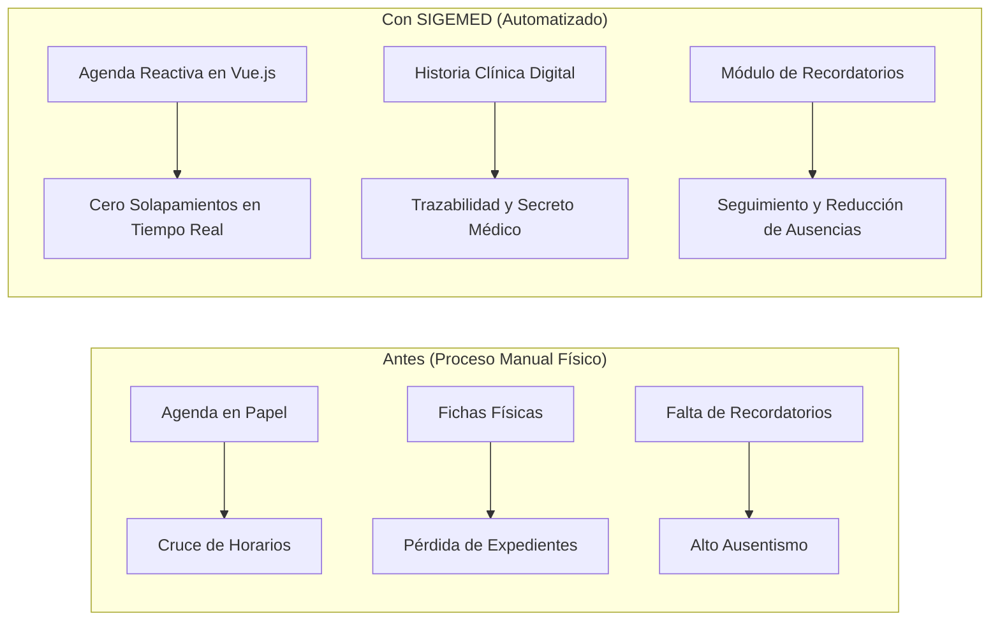

<p align="center">
  
</p>

<h1 align="center">SIGEMED — Centro Integral San Alfonso</h1>

<p align="center">
  <strong>Sistema de Información Web para la Gestión y Control de Historias Clínicas y Citas de Pacientes</strong><br>
  <em>Desarrollado para el Centro Integral de Reflexología Podal San Alfonso, C.A. (Santa Lucía, Edo. Miranda, Venezuela)</em>
</p>

<p align="center">
  
  
  
  
  
  
</p>

---

## 📌 Tabla de Contenidos

- [Acerca del Proyecto](#-acerca-del-proyecto)
- [Ficha Académica](#-ficha-académica)
- [Problemática vs. Solución](#-problemática-vs-solución)
- [Características y Módulos Principales](#-características-y-módulos-principales)
- [Matriz de Roles y Permisos](#-matriz-de-roles-y-permisos)
- [Stack Tecnológico](#-stack-tecnológico)
- [Documentación y Diagramas de Ingeniería](#-documentación-y-diagramas-de-ingeniería)
- [Requisitos del Sistema](#-requisitos-del-sistema)
- [Guía de Instalación y Despliegue Local](#-guía-de-instalación-y-despliegue-local)
- [Usuarios y Credenciales de Demostración](#-usuarios-y-credenciales-de-demostración)
- [Autor y Contacto](#-autor-y-contacto)

---

## 📖 Acerca del Proyecto

**SIGEMED** es una plataforma web integral diseñada a la medida para modernizar la gestión operativa, administrativa y médica del **Centro Integral de Reflexología Podal San Alfonso, C.A.**

El sistema reemplaza por completo el uso de agendas en papel y fichas físicas, ofreciendo una experiencia centralizada, segura y reactiva que previene el cruce de turnos, reduce el ausentismo de pacientes y garantiza el resguardo estricto del secreto médico y la trazabilidad de historias clínicas.

---

## 🎓 Ficha Académica

Este proyecto de software constituye la implementación técnica del **Trabajo Especial de Grado** para optar al título de **Técnico Superior Universitario en Informática**:

| Parámetro | Detalle |
| :--- | :--- |
| **Institución** | Instituto Universitario de Tecnología "Antonio José de Sucre" (IUTAJS) — Extensión Charallave |
| **Título de la Tesis** | *Desarrollo de un sistema de información para la gestión y control de las historias clínicas y citas de pacientes en el Centro Integral de Reflexología Podal San Alfonso, C.A. Ubicado en Santa Lucía, Estado Miranda, 2025* |
| **Línea de Investigación** | Sistemas de Información |
| **Autor** | **Santiago Alfredo Sánchez Roa** (C.I. V-31.601.397) |
| **Tutora Metodológica** | Prof. Mayira Bravo |
| **Fecha de Presentación** | Febrero, 2026 |
| **Calificación Propuesta** | 20 / 20 pts (Aprobado con Mención de Excelencia) |

---

## ⚖️ Problemática vs. Solución



* **Antes:** Tiempos de espera prolongados, ficheros desorganizados, carpetas extraviadas, riesgo de rotura o pérdida de datos confidenciales, y agendamiento manual propenso a solapar citas entre terapeutas.
* **Ahora con SIGEMED:** Búsqueda instantánea de pacientes en milisegundos, control estricto de concurrencia y disponibilidad médica, historial clínico cronológico inalterable, estadísticas gerenciales automáticas y respaldos continuos de la base de datos.

---

## 🚀 Características y Módulos Principales

### 1. 📅 Gestión Inteligente de Citas Médicas
* **Calendario Dinámico:** Vista mensual interactiva desarrollada con **Vue.js 3** para visualizar citas por estado.
* **Prevención de Cruces en Tiempo Real:** Validación asíncrona (`/api/citas/disponibilidad`) que bloquea automáticamente cualquier intento de asignar a un terapeuta a dos citas en el mismo bloque horario.
* **Control de Estados:** Flujo de ciclo de vida de la cita: `Pendiente` ➜ `Confirmada` ➜ `Completada` / `Ausente` / `Cancelada`.
* **Recordatorios de Citas:** Comando programable de consola (`citas:send-reminders`) y disparador manual desde el panel para mitigar el ausentismo.

### 2. 📋 Historia Clínica Digital (Expediente Médico)
* **Protección del Secreto Médico:** Acceso estrictamente reservado a los terapeutas y especialistas médicos.
* **Evolución y Diagnósticos:** Registro cronológico de consultas, motivo de visita, examen físico y tratamiento de reflexología podal aplicado.
* **Asociación Directa:** Vinculación directa entre la cita atendida y su correspondiente historia clínica.

### 3. 👥 Directorio y Búsqueda Reactiva de Pacientes
* **Buscador en Tiempo Real:** Componente Vue con debounce que filtra pacientes por cédula, nombres o apellidos sin recargar la página.
* **Soft Deletes:** Eliminación lógica de registros que previene pérdidas accidentales y permite la restauración inmediata por parte del administrador.

### 4. 📊 Dashboard Gerencial y Reportes
* **Paneles Adaptativos:** Vistas diferenciadas entre Administrador (Recepción) y Especialista Médico.
* **KPIs Clave:** Indicadores de citas del día, total mensual, tasa de ausentismo y número de pacientes registrados.
* **Exportación PDF:** Generación de reportes analíticos consolidados listos para auditorías o toma de decisiones gerenciales.

### 5. 🛡️ Seguridad, Respaldos y Auditoría
* **Control de Acceso Basado en Roles (RBAC):** Implementado con `spatie/laravel-permission`.
* **Respaldos de Base de Datos:** Descarga de copias de seguridad de la base de datos MySQL con un solo clic.
* **Modo Oscuro / Claro:** Soporte nativo para alternar temas visuales según la preferencia ergonómica del usuario.

---

## 🔐 Matriz de Roles y Permisos

| Módulo / Funcionalidad | Recepción / Admin | Especialista (Terapeuta) |
| :--- | :---: | :---: |
| **Agendar y editar citas** | ✅ Acceso Total | 👁️ Visualiza sus citas |
| **Registro de datos de contacto de pacientes** | ✅ Crear / Modificar | 👁️ Solo Lectura |
| **Ver y registrar Historias Clínicas** | ❌ Restringido (Secreto Médico) | ✅ Acceso Completo |
| **Administración de Usuarios y Terapeutas** | ✅ Acceso Total | ❌ Sin acceso |
| **Gestión de Especialidades Médicas** | ✅ Acceso Total | ❌ Sin acceso |
| **Generación de Reportes PDF y Estadísticas** | ✅ Acceso Total | ❌ Sin acceso |
| **Descarga de Respaldos de Base de Datos** | ✅ Acceso Total | ❌ Sin acceso |

---

## 🛠️ Stack Tecnológico

```
├── Backend:        PHP 8.1+, Laravel 10 (Arquitectura MVC, Eloquent ORM)
├── Frontend:       Blade Templates, Vue.js 3 (Options API), CSS moderno con Tokens
├── Tooling:        Vite 5, Lucide Icons, Flatpickr
├── Base de Datos:  MySQL 8.0 (Modelo Entidad-Relación normalizado)
├── Paquetes:       spatie/laravel-permission, spatie/laravel-activitylog, spatie/laravel-backup
└── Seguridad:      Bcrypt Password Hashing, CSRF Tokens, Middlewares de autorización
```

---

## 📐 Documentación y Diagramas de Ingeniería

En la raíz de este repositorio se encuentran incluidos los entregables analíticos y de ingeniería de software que respaldan la investigación académica:

* 📄 **[Carta Estructurada.pdf](Carta%20Estructurada.pdf)**: Jerarquía funcional y descomposición modular del sistema.
* 📄 **[DFD Nivel 0 (Contexto).pdf](DFD%20Nivel%200%20(Contexto).pdf)**: Diagrama de flujo de datos de nivel de contexto con entidades externas.
* 📄 **[DFD Nivel 1.pdf](DFD%20Nivel%201.pdf)**: Diagrama de flujo de datos detallado de los procesos internos.
* 📄 **[FORMATO CURSOGRAMA ANALITICO.pdf](FORMATO%20CURSOGRAMA%20ANALITICO.pdf)**: Cursograma analítico de procedimientos operativos.
* 📝 **[REQUERIMIENTOS.md](REQUERIMIENTOS.md)**: Especificación formal de requerimientos funcionales y no funcionales.
* 📘 **[Tesis Santiago Sanchez....docx](Tesis%20Santiago%20Sanchez....docx)**: Documento completo del Trabajo Especial de Grado.
* 💾 **[respaldo_san_alfonso.sql](respaldo_san_alfonso.sql)**: Respaldo SQL de la base de datos con estructura y datos de demostración.

---

## 💻 Requisitos del Sistema

* **PHP:** Versión `^8.1` o superior con extensiones (`pdo_mysql`, `mbstring`, `openssl`, `bcmath`, `curl`).
* **Composer:** Versión `2.x`.
* **Node.js & NPM:** Node.js `^18.x` o `^20.x` y NPM.
* **Servidor de Base de Datos:** MySQL `5.7+` o `8.0+` / MariaDB `10.4+`.

---

## ⚙️ Guía de Instalación y Despliegue Local

Sigue estos sencillos pasos para levantar el proyecto en tu entorno local:

### 1. Clonar el repositorio
```bash
git clone https://github.com/santiagoxx93/software_tesis.git
cd software_tesis
```

### 2. Instalar dependencias de PHP y JavaScript
```bash
composer install
npm install
```

### 3. Configurar las variables de entorno
Copia el archivo de ejemplo `.env.example` a `.env`:
```bash
cp .env.example .env
```
Configura los datos de conexión a tu servidor MySQL en el archivo `.env`:
```env
DB_CONNECTION=mysql
DB_HOST=127.0.0.1
DB_PORT=3306
DB_DATABASE=software_tesis
DB_USERNAME=tu_usuario
DB_PASSWORD=tu_contraseña
```

### 4. Generar la clave de la aplicación
```bash
php artisan key:generate
```

### 5. Ejecutar migraciones y poblar la base de datos (Seeders)
Este paso crea la estructura de tablas y carga automáticamente los usuarios de prueba, terapeutas y pacientes:
```bash
php artisan migrate --seed
```

> **Tip para datos de demostración:** Para cargar el lote completo de citas simuladas y métricas para los gráficos del dashboard, puedes ejecutar adicionalmente:
> ```bash
> php artisan db:seed --class=ThesisDataSeeder
> ```

### 6. Compilar los assets y arrancar los servidores
En una terminal inicia el compilador de Vite:
```bash
npm run dev
```

En otra terminal inicia el servidor web de desarrollo de Laravel:
```bash
php artisan serve
```

Abre tu navegador web en: `http://localhost:8000`

---

## 🔑 Usuarios y Credenciales de Demostración

El seeder del sistema (`UserSeeder`) proporciona las siguientes cuentas preconfiguradas para pruebas y evaluación de roles:

| Rol | Correo Electrónico | Contraseña | Perfil Asignado |
| :--- | :--- | :--- | :--- |
| **Administrador (Recepción)** | `admin@santalfonso.com` | `password` | Control total administrativo y agenda |
| **Especialista (Terapeuta 1)** | `terapeuta@santalfonso.com` | `password` | Dra. María González (Reflexología Podal) |
| **Especialista (Terapeuta 2)** | `terapeuta2@santalfonso.com` | `password` | Dr. Carlos Ramírez (Acupresión) |
| **Especialista (Terapeuta 3)** | `johalys@santalfonso.com` | `password` | Dra. Johalys Rangel (Terapia Holística) |

---

## 👨‍💻 Autor y Contacto

**Santiago Alfredo Sánchez Roa**  
*Técnico Superior Universitario en Informática*  
📍 Santa Lucía / Charallave, Miranda, Venezuela  
🐙 GitHub: [@santiagoxx93](https://github.com/santiagoxx93)

---

<p align="center">
  <sub>Desarrollado con dedicación y excelencia para el <strong>Centro Integral de Reflexología Podal San Alfonso, C.A.</strong> y el <strong>IUTAJS</strong>.</sub>
</p>
