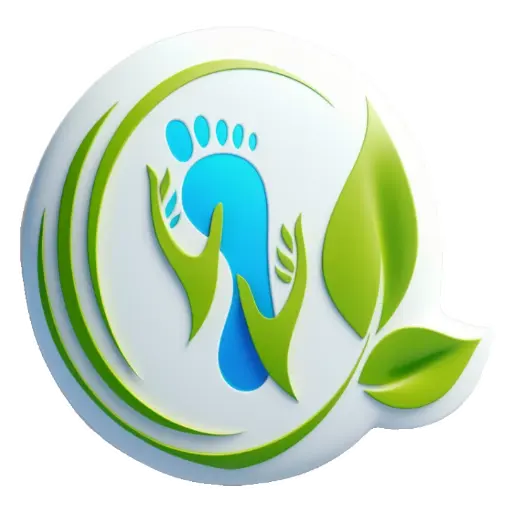
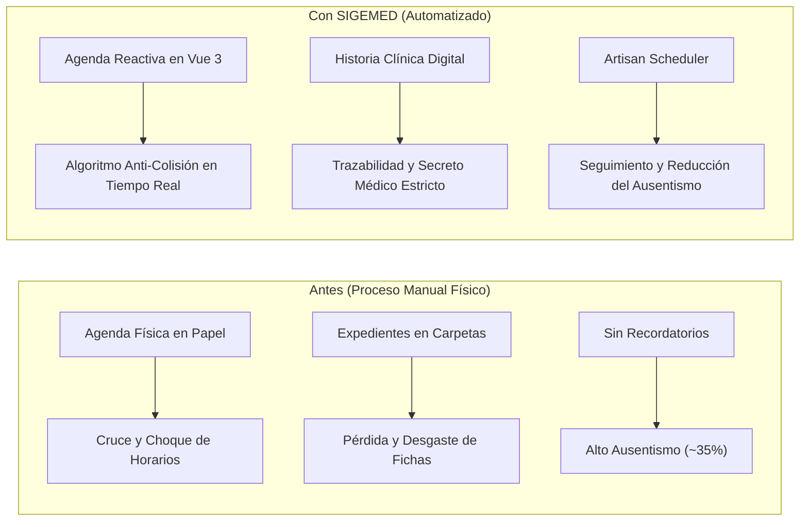
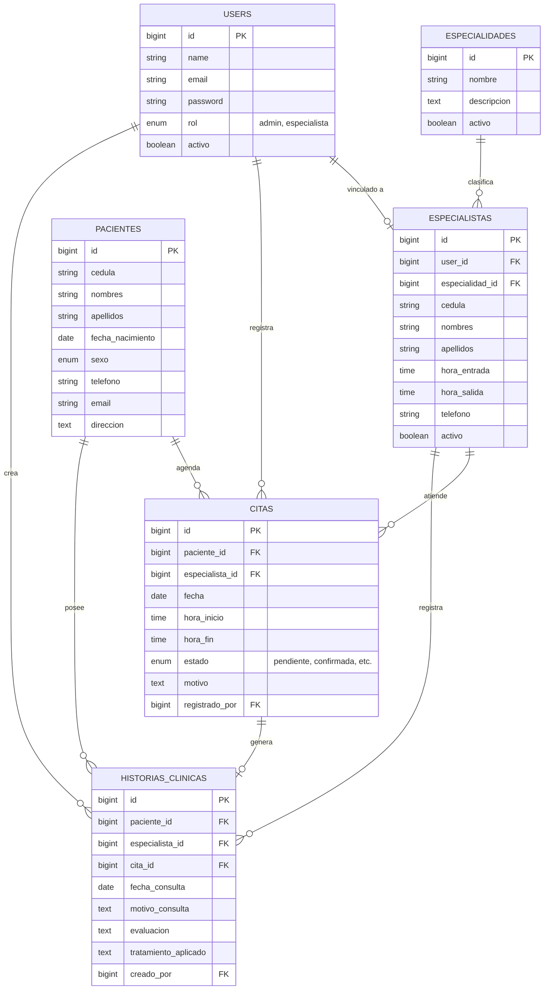

<p align="center">
  
</p>

<h1 align="center">SIGEMED — Centro Integral San Alfonso</h1>

<p align="center">
  <strong>Sistema de Información Web para la Gestión y Control de Historias Clínicas y Citas de Pacientes</strong><br>
  <em>Desarrollado para el Centro Integral de Reflexología Podal San Alfonso, C.A. (Santa Lucía, Edo. Miranda, Venezuela)</em>
</p>

<p align="center">
  <a href="https://www.linkedin.com/in/santiagoxx93" target="_blank">
    
  </a>
  <a href="https://github.com/santiagoxx93" target="_blank">
    
  </a>
  
  
  
  
</p>

---

## 📌 Tabla de Contenidos

- [Acerca del Proyecto](#-acerca-del-proyecto)
- [Ficha Académica e Institucional](#-ficha-académica-e-institucional)
- [Problemática vs. Solución de Software](#-problemática-vs-solución-de-software)
- [Retos de Ingeniería y Soluciones Implementadas](#-retos-de-ingeniería-y-soluciones-implementadas)
- [Modelo de Datos (Diagrama Entidad-Relación)](#-modelo-de-datos-diagrama-entidad-relación)
- [Módulos del Sistema](#-módulos-del-sistema)
- [Matriz de Roles y Seguridad (RBAC)](#-matriz-de-roles-y-seguridad-rbac)
- [Stack Tecnológico](#-stack-tecnológico)
- [Documentación y Entregables de Ingeniería](#-documentación-y-entregables-de-ingeniería)
- [Guía de Instalación y Despliegue Local](#-guía-de-instalación-y-despliegue-local)
- [Usuarios de Demostración](#-usuarios-de-demostración)
- [Autor y Contacto](#-autor-y-contacto)

---

## 📖 Acerca del Proyecto

**SIGEMED** es una plataforma web integral diseñada para transformar y modernizar los flujos operativos, clínicos y administrativos del **Centro Integral de Reflexología Podal San Alfonso, C.A.**

El software sustituye la gestión manual en papel por una arquitectura robusta, reactiva y segura que:
* **Elimina el 100% de solapamientos** de citas entre terapeutas mediante validación en tiempo real.
* **Reduce los tiempos de búsqueda** de expedientes médicos de 15 minutos a milisegundos.
* **Resguarda el secreto profesional médico**, restringiendo diagnósticos e intervenciones exclusivamente al personal terapéutico acreditado.
* **Mitiga el ausentismo** a través de sistemas de recordatorios y métricas analíticas automatizadas.

---

## 🎓 Ficha Académica e Institucional

Este software constituye la solución técnica del **Trabajo Especial de Grado** para optar al título de **Técnico Superior Universitario en Informática**:

| Parámetro | Detalle |
| :--- | :--- |
| **Institución** | Instituto Universitario de Tecnología "Antonio José de Sucre" (IUTAJS) — Extensión Charallave |
| **Título del Proyecto** | *Desarrollo de un sistema de información para la gestión y control de las historias clínicas y citas de pacientes en el Centro Integral de Reflexología Podal San Alfonso, C.A. Ubicado en Santa Lucía, Estado Miranda, 2025* |
| **Línea de Investigación** | Sistemas de Información |
| **Autor** | [**Santiago Alfredo Sánchez Roa**](https://www.linkedin.com/in/santiagoxx93) (C.I. V-31.601.397) |
| **Tutora Metodológica** | Prof. Mayira Bravo |
| **Fecha de Presentación** | Febrero, 2026 |
| **Calificación** | 20 / 20 pts (Aprobado con Mención de Excelencia) |

---

## ⚖️ Problemática vs. Solución de Software



---

## 💡 Retos de Ingeniería y Soluciones Implementadas

### 1. Algoritmo de Prevención de Doble Asignación (*Anti Double-Booking*)
* **Reto:** En un consultorio multidisciplinario, dos secretarias o la misma terapeuta podían agendar citas superpuestas sin notar la colisión de horario.
* **Solución:** Se implementó una verificación asíncrona (`/api/citas/disponibilidad`) en el evento `change` del formulario de citas en Vue 3. Antes del guardado definitivo, el backend verifica traslapes de intervalos de tiempo `(hora_inicio < fin_existente && hora_fin > inicio_existente)` a nivel de base de datos MySQL, retornando una alerta instantánea en UI si existe conflicto.

### 2. Secreto Médico y Control de Acceso por Roles (RBAC)
* **Reto:** Cumplir con la ética médica y la legislación de protección de datos: el personal de recepción necesita agendar citas y cobrar servicios, pero **no debe tener acceso** a los diagnósticos, evaluaciones clínicas ni notas confidenciales de reflexología.
* **Solución:** Mediante `spatie/laravel-permission` y middlewares personalizados (`admin` y `especialista`), se aislaron completamente los módulos. La recepción solo consulta perfiles y agendas; mientras que la ruta y controlador de `/historias` exige rol de especialista, asociando cada entrada a la firma digital del terapeuta que la atendió.

### 3. Arquitectura Híbrida (SSR Blade + Reactive Islands en Vue 3)
* **Reto:** Evitar la complejidad y sobrecarga de una SPA pura sin sacrificar la reactividad que demanda una agenda médica fluida.
* **Solución:** Se adoptó el patrón de **Islas Reactivas**. La autenticación, layouts y vistas administrativas renderizan velozmente mediante **Laravel Blade**, mientras que componentes de alta interacción (como el `CalendarioCitas.vue`, `BuscadorPacientes.vue` y `FormularioCita.vue`) se montan como componentes dinámicos de **Vue 3** empaquetados con **Vite**.

### 4. Automatización de Procesos y Trazabilidad
* **Reto:** Recordar a los pacientes sus citas pendientes y registrar auditorías de cambios críticos.
* **Solución:** Se construyó el comando de consola de Artisan `citas:send-reminders` para disparar notificaciones programadas, complementado con auditoría de acciones del personal mediante `spatie/laravel-activitylog` y respaldos automáticos con `spatie/laravel-backup`.

---

## 🗄️ Modelo de Datos (Diagrama Entidad-Relación)

A continuación se presenta la estructura de la base de datos relacional normalizada en MySQL:



---

## 🚀 Módulos del Sistema

1. **Agenda y Calendario Interactivo:** Vista mensual con código de colores por estado de cita (`Pendiente`, `Confirmada`, `Completada`, `Ausente`, `Cancelada`).
2. **Expediente Clínico Digital:** Evolución histórica de sesiones de reflexología podal, observaciones diagnósticas y tratamientos aplicados.
3. **Buscador de Pacientes en Tiempo Real:** Componente reactivo con *debouncing* para búsquedas instantáneas por cédula o nombre.
4. **Dashboard Analítico:** Métricas operativas en tiempo real (citas del día, volumen mensual, pacientes activos, índice de inasistencias).
5. **Generador de Reportes PDF:** Exportación formal de hojas clínicas e informes estadísticos gerenciales.
6. **Módulo de Respaldos:** Exportación y descarga directa de snapshots de la base de datos para contingencias.

---

## 🔐 Matriz de Roles y Seguridad (RBAC)

| Módulo / Funcionalidad | Recepción / Admin | Especialista (Terapeuta) |
| :--- | :---: | :---: |
| **Agendar y reprogramar citas** | ✅ Acceso Total | 👁️ Visualiza sus citas asignadas |
| **Gestión de Pacientes (Registro / Edición)** | ✅ Completo | 👁️ Solo Lectura |
| **Historias Clínicas (Diagnóstico y Evolución)** | ❌ **Restringido (Secreto Médico)** | ✅ **Acceso Total y Edición** |
| **Gestión de Personal y Especialistas** | ✅ Acceso Total | ❌ Sin acceso |
| **Reportes Gerenciales y Estadísticas** | ✅ Acceso Total | ❌ Sin acceso |
| **Descarga de Respaldos de BD** | ✅ Acceso Total | ❌ Sin acceso |

---

## 🛠️ Stack Tecnológico

```
├── Backend:        PHP 8.1+, Laravel 10 (Arquitectura MVC, Eloquent ORM, Seeders)
├── Frontend:       Blade Templates, Vue.js 3.4 (Options API), CSS Moderno con Tokens
├── Tooling:        Vite 5, Lucide Icons, Flatpickr
├── Base de Datos:  MySQL 8.0 (Relacional, Soft Deletes, Integridad Referencial)
├── Librerías:      spatie/laravel-permission, spatie/laravel-activitylog, spatie/laravel-backup
└── Seguridad:      Bcrypt Hashing, CSRF Tokens, Middlewares RBAC
```

---

## 📁 Documentación y Entregables de Ingeniería

Todos los entregables de análisis, diseño y documentación de software se encuentran organizados dentro del proyecto:

* 📄 **[Carta Estructurada (PDF)](docs/Carta_Estructurada.pdf)**: Jerarquía de módulos y subprocesos.
* 📄 **[DFD Nivel 0 - Contexto (PDF)](docs/DFD_Nivel_0_Contexto.pdf)**: Diagrama de flujo de datos del entorno global.
* 📄 **[DFD Nivel 1 - Procesos (PDF)](docs/DFD_Nivel_1.pdf)**: Descomposición detallada de flujos de datos internos.
* 📄 **[Formato Cursograma Analítico (PDF)](docs/Formato_Cursograma_Analitico.pdf)**: Flujograma de operaciones y decisiones.
* 📝 **[Especificación de Requerimientos (MD)](docs/REQUERIMIENTOS.md)**: Requerimientos funcionales y no funcionales.
* 📘 **[Tesis de Grado Completa (Word)](docs/Tesis_Santiago_Sanchez.docx)**: Documento monográfico de la investigación.
* 💾 **[Respaldo de Base de Datos (SQL)](database/backup/respaldo_san_alfonso.sql)**: Dump completo de la estructura y datos demo.

---

## ⚙️ Guía de Instalación y Despliegue Local

### 1. Clonar el repositorio
```bash
git clone https://github.com/santiagoxx93/software_tesis.git
cd software_tesis
```

### 2. Instalar dependencias
```bash
composer install
npm install
```

### 3. Configurar variables de entorno
```bash
cp .env.example .env
```
Configura tus credenciales de MySQL en el archivo `.env`:
```env
DB_CONNECTION=mysql
DB_HOST=127.0.0.1
DB_PORT=3306
DB_DATABASE=software_tesis
DB_USERNAME=tu_usuario
DB_PASSWORD=tu_contraseña
```

### 4. Generar App Key y migrar base de datos
```bash
php artisan key:generate
php artisan migrate --seed
```

> **Datos de prueba para gráficos:** Para cargar 85 citas simuladas y enriquecer los gráficos analíticos del dashboard, ejecuta:
> ```bash
> php artisan db:seed --class=ThesisDataSeeder
> ```

### 5. Compilar assets y levantar el servidor
En una terminal:
```bash
npm run dev
```

En otra terminal:
```bash
php artisan serve
```

Ingresa en tu navegador a: `http://localhost:8000`

---

## 🔑 Usuarios de Demostración

| Rol | Correo Electrónico | Contraseña | Perfil Asignado |
| :--- | :--- | :--- | :--- |
| **Administrador (Recepción)** | `admin@santalfonso.com` | `password` | Control Administrativo y Agenda |
| **Especialista (Terapeuta 1)** | `terapeuta@santalfonso.com` | `password` | Dra. María González (Reflexología Podal) |
| **Especialista (Terapeuta 2)** | `terapeuta2@santalfonso.com` | `password` | Dr. Carlos Ramírez (Acupresión) |
| **Especialista (Terapeuta 3)** | `johalys@santalfonso.com` | `password` | Dra. Johalys Rangel (Terapia Holística) |

---

## 👨‍💻 Autor y Contacto

<p align="left">
  <strong>Santiago Alfredo Sánchez Roa</strong><br>
  <em>Técnico Superior Universitario en Informática</em><br>
  📍 Miranda, Venezuela
</p>

<p align="left">
  <a href="https://www.linkedin.com/in/santiagoxx93" target="_blank">
    
  </a>
  <a href="https://github.com/santiagoxx93" target="_blank">
    
  </a>
</p>

---

<p align="center">
  <sub>Desarrollado con altos estándares de calidad técnica para el <strong>Centro Integral de Reflexología Podal San Alfonso, C.A.</strong> y el <strong>IUTAJS</strong>.</sub>
</p>
